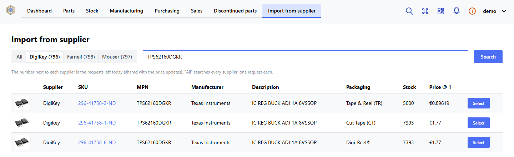
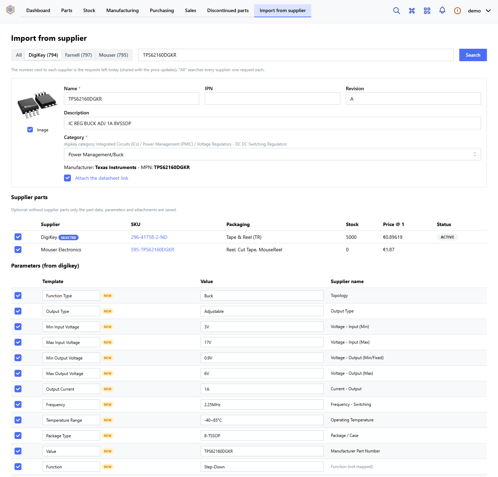

# inventree-supplier-part-import

[InvenTree](https://inventree.org) plugin (>= 1.0) that searches parts on **Mouser**, **DigiKey** and **Farnell** and
creates them in InvenTree: part, manufacturer part, supplier parts with prices, category, parameters, datasheet, image
and RoHS / REACH declarations, with the import rules of [Ki-nTree](https://github.com/sparkmicro/Ki-nTree).

It **requires [inventree-part-pricing-update](https://github.com/Kamaar/inventree-part-pricing-update)**, which
provides:

- the supplier API credentials and the linked supplier companies;
- the daily request quota: searches count in the same counter as the price updates;
- prices, availability and price history of the created supplier parts.

When *Part Pricing Update* is not active, the page only asks to activate it.

## Screenshots

Search on one supplier (or all of them), with the requests left today:



The form prepared from the selected product: category proposed from the mappings, supplier parts of the other
suppliers, parameters mapped to the InvenTree templates and converted to their units, RoHS / REACH:



## Usage

Menu **Import from supplier**, or `/web/plugin/supplier-part-import/import`.

1. **Search** a supplier code, an MPN or keywords on one supplier (or all of them). Each supplier shows the requests left
   today. Results already in InvenTree are marked with their IPN.
2. **Select** a result. The plugin prepares the form with these requests:
   - the product details;
   - the same MPN on the supplier with the best parameters (DigiKey, then Farnell, then Mouser: the Mouser API reports
     few technical parameters);
   - the same MPN on the other suppliers, as **alternate suppliers**;
   - the RoHS / REACH declarations of the manufacturer (DigiKey).
3. **Check and edit** the form: name, description, category, IPN, revision, supplier parts to create, parameters
   (template, value, included or not), image, datasheet and declarations.
4. **Create the part**, or **update the existing part** (see below). Supplier parts are optional: without them only the
   part data, parameters and attachments are saved. The plugin creates the part, the manufacturer part (and the
   manufacturer if missing), the supplier parts with prices and history, the parameters and the attachments, then opens
   the part.

### Products already in InvenTree: no duplicates

Before creating a part the plugin looks for the product in InvenTree, comparing codes without case and separators
(`8850-1210-7027` = `885012107027`):

- the **MPN** of the manufacturer parts;
- the **SKU** of the supplier parts of **any supplier** (e.g. a part with only a Würth supplier part, whose SKU is the MPN);
- the **part name**, often the MPN;
- the **old names** of a renamed product, reported by DigiKey in `OtherNames` (e.g. a search for 0402ZD224KAT2A returns
  KGM05AR51A224KH, and the part with the old MPN is still found);
- the **searched code**: shown but not preselected, since a keyword search may return other products.

When a part is found, the form proposes to **update** it, with the suppliers it already has:

- only the **missing supplier parts** are added (the existing ones are marked and cannot be selected);
- the manufacturer part is created only if missing;
- optionally the **missing parameters and attachments** are added;
- parameters the part already has are marked *already set*. The ones with a placeholder value (`-`, `n/a`, …) are
  preselected; the others can be selected to **replace** the current value (badge *replaces*), reported in the summary;
- description, IPN and category of the existing part are never changed.

Creating a new part anyway needs the explicit choice *Create a new part anyway (duplicate)*; otherwise the server refuses.

### Rules

- **Category**: proposed from the mappings *supplier category → InvenTree category*.
  - Ki-nTree subcategories with the `__` prefix (e.g. `__N-Channel FET`) are *filtered by function*: among the ones of
    the same supplier category, the plugin picks the one whose name matches the `Function Type` parameter
    (e.g. `FET Type` = `N-Channel` → *N-Channel FET*). If none matches, the parent category is proposed, as in Ki-nTree.
  - DigiKey v3 category names (`Transistors - FETs, MOSFETs - Single`) are also matched on the v4 paths.
  - For an unmapped supplier category you choose the category; with *Remember* the choice becomes a new mapping.
    Changing the category recalculates parameters and IPN without new supplier requests.
  - A mapped category which does not exist yet is proposed with the *new* badge and created only when the import is
    confirmed (see *Default mappings*).
- **Parameters**: mapping per category as in Ki-nTree (`supplier_parameters.yaml`, with `parent`) and the same value
  clean-up (`clean_parameter_value`): metric sizes, ranges `-55~125°C`, package without description. Difference from
  Ki-nTree: *Package Height/Size* keep the millimetres, not the inches. With *Import all the parameters*, the unmapped
  parameters are imported with the supplier name. As in Ki-nTree, `Manufacturer Part Number` in the mappings means the
  MPN (e.g. `Value` ← MPN for diodes, transistors and ICs). Farnell `… Min` / `… Max` pairs become a range and the
  Farnell formats follow the DigiKey ones (`10kohm` → `10K`, `0.02ohm` → `0.02R`, `± 10%` → `±10%`). When updating an
  existing part the unmapped parameters start unselected. *Ignored parameters* are never imported. Missing templates are
  created with the units of `parameters.yaml`.
- **Units**: for templates with units InvenTree shows the unit in its own column, so the value is saved as a number in
  the template units: `25V` (unit V) → `25`, `-55~85°C` → `-55~85`, `±20%` → `±20`, `20mR` (unit mΩ) → `20`, with the
  InvenTree conversion. Templates without units keep the unit in the value, without space (`22 µF` → `22µF`). In the
  settings page, *Parameter units* applies the same conversion to the existing parameters: *Check* shows the changes,
  *Convert* applies them; values which cannot be converted are listed and left unchanged.
- **RoHS / REACH**: the parameters `Stato RoHS`, `REACH` and the `RoHS` checkbox, with Italian values
  (`Conforme (RoHS3)`, `Conforme (nessuna SVHC)`, …). Sources, in order: DigiKey, Farnell, Mouser (Mouser only RoHS).
  The declarations are attached as links with the note `Dichiarazione RoHS/REACH - <title>`.
- **Datasheet**: attached as a link with the note `Datasheet`.
- **IPN** (can be disabled with *Propose IPN*): the first free number with the scheme
  `<type prefix><mounting digit>-<number>` (e.g. `PE061-0012`):
  - the type prefix (letters + 2 digits, `PE06`) is the most common one among the IPNs of the category, or of the
    parent categories when it is empty;
  - the mounting digit comes from the supplier *Mounting Type* (SMD 1, THD 2, panel 3, wire 6);
  - the IPN stays editable. With other IPN schemes, disable *Propose IPN*.

## Installation

Both plugins are installed from their repositories, **pricing first**: this plugin depends on it, and it is not on PyPI.
Always use **version tags**: without a tag pip does not download new commits.

**With `plugins.txt`** (InvenTree data folder), both lines:

```
inventree-part-pricing-update @ git+https://github.com/Kamaar/inventree-part-pricing-update@v0.4.17
inventree-supplier-part-import @ git+https://github.com/Kamaar/inventree-supplier-part-import@v0.1.21
```

**From the InvenTree UI** (*Settings → Plugins → Install plugin*), first the pricing plugin (see its README), then:

- *Package Name*: `inventree-supplier-part-import`
- *Source URL*: `git+https://github.com/Kamaar/inventree-supplier-part-import@v0.1.21`

With Docker, install in **both** the server and the worker container and restart them (different versions cause the
*Plugin Registry Mismatch* error, INVE-E20):

```bash
docker compose exec inventree-server invoke plugins
docker compose exec inventree-worker invoke plugins
docker compose restart inventree-server inventree-worker
```

Then activate **Supplier Part Import** (app, URL and interface integration must be enabled in *Settings → Plugins*) and
run the migrations (`invoke migrate`, or `INVENTREE_AUTO_UPDATE=True` in Docker).

The packages can also be published to a private PyPI registry (e.g. GitLab): then set `PIP_EXTRA_INDEX_URL` in the
InvenTree `.env` and list the package names without version in `plugins.txt`.

### Default mappings

The plugin ships default mappings in `supplier_part_import/defaults`, from the Ki-nTree configuration:

- `categories.yaml`: category tree;
- `digikey_categories.yaml`: DigiKey categories → InvenTree categories, plus the v4 names of categories Ki-nTree did not
  cover (NTC, PMIC, batteries and holders, nuts and screws, RF shields, antennas, RF modules);
- `mouser_categories.yaml` and `farnell_categories.yaml`: the same categories for Mouser and Farnell, so that a product
  sold only by them gets a proposed category. Farnell reports no category: the product type in the name is used
  (English store: *Power Inductor (SMD)*). The names come from sample parts;
- `supplier_parameters.yaml`: supplier parameters → InvenTree templates, with the Farnell names. Differences from
  Ki-nTree: the DC resistance of the inductors goes to *DC Resistance* (not *ESR*), *Collector Gate Voltage* has the same
  name as in `parameters.yaml`, and *B Constant* (NTC), *Output Current* and *RDS On Voltage* are mapped;
- `parameters.yaml`: template units.

On the first use (import page or plugin settings), if the mapping tables are empty, parameter scopes and units are
loaded automatically; an existing configuration is never changed. Mappings to categories which do not exist in InvenTree
stay **pending** (badge *pending* in the settings):

- when a product of that kind is imported, the category is proposed with the *new* badge and created, with its missing
  parents, only when the import is confirmed; choosing another category creates nothing;
- a category created by hand in InvenTree links its pending mappings automatically.

So the category tree grows only with the categories really needed. In the *Default mappings* section of the settings,
**Load default mappings** can:

- add only the missing rows (your changes are kept);
- with *Replace the existing rows*, start again from the defaults;
- with *Create the missing InvenTree categories*, create at once all the missing categories of `categories.yaml`.

Parameter scopes and category mappings can then be edited in the same page.

### Inductor DC resistance (from ESR to DC Resistance)

Ki-nTree saved the DC resistance of the inductors in the *ESR* template; the default mappings use *DC Resistance*. To
align a configuration imported from Ki-nTree and the existing values:

```bash
docker compose exec -w /home/inventree/src/backend/InvenTree inventree-server python manage.py shell \
    -c "from supplier_part_import.maintenance import move_inductor_dcr; move_inductor_dcr()"
```

Without `apply=True` nothing is written: it only shows what would change. With `move_inductor_dcr(apply=True)`:

- in the *Inductors* parameter scope the DCR names move from *ESR* to *DC Resistance*;
- the *DC Resistance* template is created if missing (unit mΩ);
- for the parts of the *Inductors* category (and subcategories) the *ESR* parameter becomes *DC Resistance*, with the
  same value. Parts which already have *DC Resistance* are listed and left unchanged.

Running it again changes nothing. Back up the database before applying it.

### Import from Ki-nTree

Ki-nTree users can load their own files from `~/kintree/user` (Windows `C:\Users\<user>\kintree\user`) in the
*Import from Ki-nTree* section: `digikey_categories.yaml`, `supplier_parameters*.yaml`, `parameters.yaml`. Mappings to
missing categories stay pending, as above.

## Settings

| Setting | Default | |
|---|---|---|
| Propose IPN | yes | Propose the next free IPN |
| IPN digits | 4 | Digits of the progressive number |
| Default revision | A | Revision of the new parts |
| Parameter sources | digikey, farnell, mouser | Suppliers used for parameters and category, in order |
| Farnell store for the parameters | uk.farnell.com | Farnell answers in the store language: the parameters are read from the English store (1 request), prices and stock from the store of the pricing plugin |
| Import all the parameters | yes | Import also the unmapped parameters |
| Ignored parameters | Farnell internal fields… | Never imported |
| Alternate suppliers | yes | Propose the supplier parts of the other suppliers |
| RoHS / REACH declarations | yes | Attach the manufacturer declarations (1 DigiKey request) |

## Development

```bash
uv run --no-project --with pytest --with pyyaml pytest        # import rules (no Django)
cd frontend && npm install && npm run lint && npm run build   # frontend in supplier_part_import/static
```

**Integration tests** on a real InvenTree (default mappings, categories, duplicates, parameters, maintenance) are in
`tests/integration`. They need a migrated InvenTree with the pricing plugin installed and, besides the database
variables, `INVENTREE_SRC` (the `src/backend/InvenTree` folder), `INVENTREE_PLUGINS_ENABLED=True`,
`INVENTREE_PLUGIN_TESTING=True`, `INVENTREE_PLUGIN_TESTING_SETUP=True` and
`INVENTREE_PLUGINS_MANDATORY=part-pricing-update,supplier-part-import`:

```bash
python -m pytest tests/integration    # with the Python of the InvenTree environment
```

Every test runs in a transaction which is rolled back. In CI they run on the `inventree/inventree:stable` image; a
weekly scheduled pipeline catches the changes of new InvenTree releases.

Code style: Ruff (Python) and Biome (frontend, `biome.json`); `pip install pre-commit && pre-commit install` runs them
at every commit. LF line endings (`.gitattributes`, `.editorconfig`).

Plugin metadata: `PLUGIN_VERSION` and `PLUGIN_DATE` in `__init__.py`, updated at every release.
`MAX_VERSION = '1.99.99'`: on a new major InvenTree version the plugin is not loaded until it has been checked (it has
its own tables and migrations, `AppMixin`).

Release: update the version in `supplier_part_import/__init__.py` and `frontend/package.json`, then tag `vX.Y.Z`
(`tools/check_version.py` checks that the tag matches `PLUGIN_VERSION`).

## Credits

- **[Ki-nTree](https://github.com/sparkmicro/Ki-nTree)** (sparkmicro and contributors, GPL-3.0): the import rules are
  ported from Ki-nTree:
  - parameter mapping per category, with the `parent` inheritance of `supplier_parameters.yaml`;
  - value clean-up (`common/part_tools.clean_parameter_value`);
  - supplier categories → InvenTree categories, with the `__` subcategories filtered by function;
  - format of the configuration files and the default mappings.

  This is why the plugin is GPL-3.0.
- **[InvenTree](https://inventree.org)**: [plugin documentation](https://docs.inventree.org/en/stable/plugins/) and
  frontend structure from the [plugin-creator](https://github.com/inventree/plugin-creator) template (MIT).
- **[inventree-part-pricing-update](https://github.com/Kamaar/inventree-part-pricing-update)**: supplier API
  clients, credentials and daily quota.
- Supplier APIs: Mouser Search API, DigiKey Product Information v4, element14 Product Search API. Mouser, DigiKey,
  Farnell and element14 are trademarks of their owners.

## License

GPL-3.0-or-later, see [LICENSE](LICENSE). Copyright (c) 2026 Simone Amadori.
